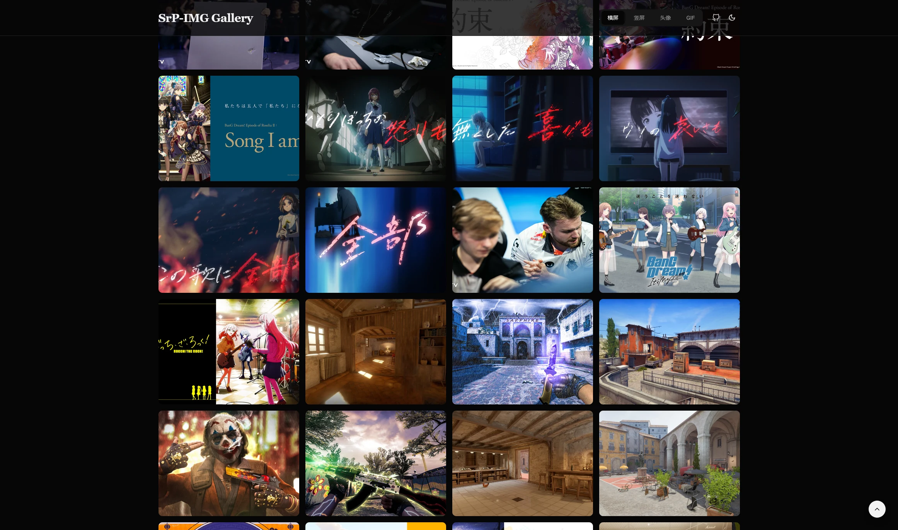

<h1 align="center">SrP-IMG — Random Image API & Gallery</h1>

<p align="center">
  <b>English</b> • <a href="./README_zh.md">简体中文</a>
</p>

<p align="center">
  <a href="https://github.com/RolinShmily/SrP-IMG/actions/workflows/deploy.yml"></a>
  <a href="https://github.com/RolinShmily/SrP-IMG/actions/workflows/ci.yml"></a>
  <a href="LICENSE"></a>
  <a href="https://nextjs.org"></a>
  <a href="https://workers.cloudflare.com"></a>
</p>

A lightweight, serverless multi-category random image API and visual gallery built on **Cloudflare Workers / Pages**. It uses Python pre-build hashing to distribute static images across deterministic random slots, offering low latency and zero maintenance.

### ✨ Core Features

* **Serverless Architecture**: Hosted on Cloudflare Workers / Pages — no dedicated servers or databases to maintain.
* **Fully Automated Multi-Category Support**: Supports `h` (landscape), `v` (portrait), `a` (avatars), `gif` (animated GIFs), and custom folders with zero frontend code modification.
* **Auto Format Detection**: Enforces `.jpg` for `h/v` for universal API client compatibility, while automatically detecting and preserving original extensions (e.g., `.gif`, `.jpeg`, `.png`) for custom categories.
* **Adaptive Waterfall Gallery**: Automatically derives categories, item counts, and aspect ratios from build metadata; supports English/Chinese i18n, dark/light themes, and Fancybox previews.
* **Dual Access Modes**: Server-side 302 redirection (API Mode) and Cloudflare Transform Rules edge rewrite (Transparent Mode).
* **Built-in Security Boundaries**: Referer hotlinking protection (allowing empty Referer for Markdown/direct access) and dynamic CORS policy.

---

### 📁 Directory Structure

```text
├── oriImg/                 # [Core] Raw source images (organized by category folders)
│   ├── h/                  # Landscape images (enforced .jpg)
│   ├── v/                  # Portrait images (enforced .jpg)
│   ├── a/                  # Avatar images
│   └── gif/                # Custom category (preserves .gif format)
├── public/                 # Static assets & build outputs
│   ├── counts.json         # Auto-generated global index & metadata
│   └── h/, v/, a/, gif/    # Mapped hex-named image collections
├── functions/              # Cloudflare Pages Functions
│   └── pic.js              # Server-side redirect API endpoint (Pages)
├── app/                    # Next.js App Router
│   ├── page.tsx            # Home showcase & live interactive demo
│   ├── gallery/            # Dedicated waterfall gallery page
│   ├── settings/           # API guide & edge configuration center
│   ├── template.tsx        # Client route enter transition wrapper
│   └── layout.tsx          # Root layout & global metadata
├── components/             # React UI components
│   ├── access-policy-panel.tsx # Hotlink & access policy visual editor
│   ├── live-preview.tsx    # Live image preview container (zero-crop)
│   ├── image-gallery.tsx   # Core waterfall gallery component
│   └── api-panel.tsx       # Interactive API copy & rule generator panel
├── lib/                    # Shared libraries & typed translations
│   ├── i18n.tsx            # Internationalization context & core strings
│   ├── api-translations.ts # API guide bilingual translations
│   └── gallery-translations.ts # Gallery bilingual translations
├── scripts/                # Build & normalization utilities
│   └── normalize-static-export.mjs # Static export segment path normalizer
├── tests/                  # Automated test suite
│   ├── backend-contract.test.mjs   # Worker / Pages security & HTTP contract tests
│   ├── static-export.test.mjs      # Next.js static export regression tests
│   └── test_access_policy.py       # Access policy generator & validation tests
├── gen_img.py              # Build script: asset scanning, hash mapping & metadata generation
├── access-policy.json      # Build-time Referer/CORS and image access policy
├── index.js                # Cloudflare Workers entrypoint
├── wrangler.jsonc          # Cloudflare Workers configuration
├── README.md               # English documentation
└── README_zh.md            # Chinese documentation
```

---

### 🖥️ Preview



---

### 🚀 Deployment Guide

#### 1. Material Preparation

Create category folders inside `oriImg/` in the project root:

* **Built-in Categories**: Place avatar images in `a/`, GIF animations in `gif/`, landscape images in `h/`, and portrait images in `v/`. Categories `h` and `v` enforce `.jpg` for universal API compatibility.
* **Custom Categories**: Create any folder such as `oriImg/wallpaper/` or `oriImg/anime/`. The prebuild engine automatically detects the folder and preserves the file extension of the first image.

#### 2. Build & Deployment Commands

The project includes convenient npm scripts for the workflow:

| Command | Description |
| :--- | :--- |
| `npm run gen` | Execute asset hash diffusion and entry generation (`python gen_img.py --hash-length 2`) |
| `npm run build:all` | One-click command to run pre-build generation and Next.js static build (`npm run gen && npm run build`) |
| `npm run deploy` | Execute Wrangler deployment to Cloudflare Worker (`wrangler deploy`) |
| `npm run dev` | Start local Next.js development server |
| `npm run build` | Build Next.js static export (`out/`) |

`npm run build` also normalizes Next.js 16 segment filenames on Windows so static route prefetch requests resolve correctly; Linux exports are unchanged.

#### 3. Local Testing

To preview the gallery locally:

```bash
# Use --no-copy to quickly generate virtual metadata for testing without copying files
python gen_img.py --no-copy --hash-length 2
npm run dev
```

To test the random endpoint and access policy in the Cloudflare runtime, run `npm run build`, then `npx wrangler dev --local`, and open the URL Wrangler prints. On Windows, stop this local Wrangler process before rebuilding because it holds the `out/` directory open. The Next.js development server alone does not execute the Worker.

#### 4. Cloudflare Pages / Workers Production Build

Configure Cloudflare Pages as follows:

* **Framework Preset**: `Next.js`
* **Build Command**: `npm run build:all` (or `python3 gen_img.py --hash-length 2 && npm run build`)
* **Build Output Directory**: `out`
* **Environment**: Python 3.8+

If deploying to **Cloudflare Workers**, configure `wrangler.jsonc`:

```jsonc
{
  "name": "srp-img-worker",
  "main": "index.js",
  "compatibility_date": "2026-01-05",
  "compatibility_flags": ["nodejs_compat"],
  "assets": {
    "directory": "./out",
    "binding": "ASSETS",
    "run_worker_first": true
  }
}
```

*Note: Replace `name` with your Worker name, and set `compatibility_date` to your deployment date.*
Deploy command: `npm run deploy` (or `npx wrangler deploy`)

---

### 💡 Usage & Integration

#### Method A: Serverless API (JS Redirection)

Powered by `functions/pic.js` (Pages: `/pic`) or `index.js` (Workers: `/pic` and `/api/pic`). Configure the access policy below before embedding in external websites:

| Endpoint | Target / Behavior | Description |
| :--- | :--- | :--- |
| `/pic?img=a` | 302 Redirect to `/a/xxx.jpeg` | Random avatar image |
| `/pic?img=gif` | 302 Redirect to `/gif/xxx.gif` | Random GIF animation |
| `/pic?img=h` | 302 Redirect to `/h/xxx.jpg` | Random landscape image |
| `/pic?img=v` | 302 Redirect to `/v/xxx.jpg` | Random portrait image |
| `/pic?img=ua` | Smart UA-based redirection | Returns vertical for mobile, horizontal for desktop |

> **Custom Categories**: Place images in `oriImg/<custom-category>` (e.g., `oriImg/wallpaper`). The prebuild engine automatically extracts metadata and enables `?img=<custom-category>` out of the box without code modifications.

#### Method B: Visual Web Gallery

Visit your deployed root domain (e.g., `https://your-domain.pages.dev`):

* **Responsive Filtering**: Top navigation switches between `h`, `v`, `gif`, and custom categories.
* **Waterfall Masonry**: High-performance loading powered by Next.js.
* **Immersive Preview**: Integrated Fancybox with zoom, rotate, fullscreen, and download capabilities.

#### Method C: Edge URL Rewrite (Transparent Mode)

Configure **Transform Rules** in the Cloudflare Dashboard (*Replace `<your-domain>` with your actual domain*):

**Rule 1: Landscape / Portrait (`h` & `v`)**

1. **Match Expression**:

```text
(http.host eq "<your-domain>" and starts_with(http.request.uri.path, "/h") and not ends_with(http.request.uri.path, ".jpg")) or (http.host eq "<your-domain>" and starts_with(http.request.uri.path, "/v") and not ends_with(http.request.uri.path, ".jpg"))
```

2. **Rewrite Path (Dynamic)**:

```text
concat(http.request.uri.path, "/", substring(uuidv4(cf.random_seed), 0, 2), ".jpg")
```

**Rule 2: Avatar Category (`a`)**

1. **Match Expression**:

```text
(http.host eq "<your-domain>" and starts_with(http.request.uri.path, "/a") and not ends_with(http.request.uri.path, ".jpeg"))
```

2. **Rewrite Path (Dynamic)**:

```text
concat(http.request.uri.path, "/", substring(uuidv4(cf.random_seed), 0, 2), ".jpeg")
```

**Rule 3: GIF Category (`gif`)**

1. **Match Expression**:

```text
(http.host eq "<your-domain>" and starts_with(http.request.uri.path, "/gif") and not ends_with(http.request.uri.path, ".gif"))
```

2. **Rewrite Path (Dynamic)**:

```text
concat(http.request.uri.path, "/", substring(uuidv4(cf.random_seed), 0, 2), ".gif")
```

> **Note**: If `--hash-length` is set to `3` in your build command, update the substring length in `cf.random_seed` from `2` to `3`.
> Example access URL: `https://your-domain.pages.dev/h`

---

### 🛡️ Security Boundaries & Anti-Hotlinking

The Config & API page includes a bilingual policy editor with validation, JSON preview, and configuration download. It edits a browser draft; it does not change the deployed service.

[access-policy.json](./access-policy.json) is the single build-time configuration for both generated backends. Edit it, then regenerate before building/deploying; editing the JSON after deployment has no effect. The generated `index.js` and `functions/pic.js` explicitly include the policy and matching rules in comments.

```bash
python gen_img.py --access-policy ./access-policy.json --hash-length 2
```

`--access-policy` is optional: the default is `./access-policy.json` in the working directory. If that implicit file is absent, the same portable defaults apply. An explicitly selected missing/invalid file, unknown/missing fields, invalid host patterns, or invalid origins fail the build before image output changes. No project domain or localhost exception is hardcoded.

The complete v1 configuration (all fields required) defaults to:

```json
{
  "version": 1,
  "referer": {
    "enabled": true,
    "allowMissing": true,
    "allowSameOrigin": true,
    "allowedHosts": []
  },
  "cors": {
    "allowSameOrigin": true,
    "allowedOrigins": []
  },
  "protectAssetImages": true
}
```

| Setting | Behavior |
| :--- | :--- |
| `referer.enabled` | Enable Referer checks. Disabling this does not disable Origin checks. |
| `referer.allowMissing` | Allow absent/empty Referer, useful for direct requests, curl, and Markdown. Set false to require Referer on GET/HEAD. |
| `referer.allowSameOrigin` | Allow a Referer whose origin matches the actual request URL (scheme, host, and port). |
| `referer.allowedHosts` | Case-insensitive exact hostnames/IPs or `*.example.com` suffix patterns; no scheme, path, or port. A wildcard matches `a.example.com` and `a.b.example.com`, but excludes `example.com` and `badexample.com`. Add the root hostname separately. Exact hosts do not include subdomains. Use ASCII/punycode for international names. |
| `cors.allowSameOrigin` | Allow an Origin matching the actual request URL. |
| `cors.allowedOrigins` | Independent exact origins, e.g. `["https://client.example", "http://localhost:3000"]`. Include scheme and any nondefault port; no path, trailing slash, credentials, `null`, or wildcards. Scheme/port differences require separate entries. |
| `protectAssetImages` | In Workers, apply both checks to image files in generated category directories. It does not add Pages middleware. |

A supplied invalid or unauthorized `Origin` receives **403**, including preflight and requests that have an allowed/missing Referer. An absent Origin is allowed, then Referer policy is evaluated separately; an invalid or unauthorized Referer also receives **403**. To allow another web application, configure its origin for fetch/XHR and its host for image embedding as needed. CORS membership does not grant Referer membership.

Only GET, HEAD, and OPTIONS are supported on protected routes. OPTIONS validates Origin, requested method, and header names, returns 204 when accepted, and deliberately does not require Referer (browsers may omit it). Unsupported methods return 405. HEAD returns the same status/headers with no body, including errors. Redirects, protected assets, and errors carry `Vary: Origin, Referer` and `Cache-Control: private, no-store`; preflights additionally vary on requested method/header names. Existing asset Vary values are preserved. These headers avoid sharing an allow/deny response across callers; overriding them with a cache-everything rule can invalidate the boundary.

**Deployment boundaries**:

* **Workers**: `/pic` and `/api/pic` are protected. With `protectAssetImages: true`, `/<generated-category>/<filename>.jpg|jpeg|png|gif|webp` is also checked, including redirect destinations and decoded paths. Keep `assets.run_worker_first: true` in `wrangler.jsonc`: Cloudflare's default asset-first routing otherwise serves existing files without invoking the Worker. HTML pages, `counts.json`, JavaScript/CSS, icons, and unrelated assets remain public. All requests now invoke the Worker, which affects request billing/limits; accepted images still use the ASSETS binding internally.
* **Pages**: `functions/pic.js` protects `/pic` only. A separate Pages function/rewrite is needed for `/api/pic`; this repository does not generate that alias. Static image files and Transform Rule rewrites can bypass the redirect function. Use Pages middleware or account-level WAF/hotlink rules if those must be protected. The `protectAssetImages` switch alone cannot protect Pages static files.
* **Header checks are not authentication**: clients can omit or forge headers; allowing missing Referer permits such requests by design. Even with missing Referer denied, a nonbrowser client can forge an allowed value. Use authentication/signed URLs or account-level controls for confidential assets or stronger abuse protection.

Run the backend contract checks without installing dependencies or regenerating repository image pools:

```bash
node --test tests/backend-contract.test.mjs
python -m unittest discover -s tests -p test_access_policy.py -v
```

---

### ⚙️ Technical Details

#### Build Engine: `gen_img.py`

When executed, the script performs:

1. **Hash Expansion**: Uses `--hash-length` to define the random pool size. For length `3`, each category generates $16^3 = 4096$ paths.
2. **Extension Strategy**:
   * Inspects each subdirectory under `oriImg`.
   * If named `h` or `v`, enforces the CLI extension (defaults to `.jpg`).
   * Otherwise, auto-detects the extension from the first image in that directory.
3. **Metadata Export**: Generates `counts.json` containing total image counts (`counts`) and extension mappings (`category_exts`).

---

### 📦 Storage & Capacity Management

Because Cloudflare Pages and other CI platforms enforce limits on file counts and total artifact sizes, this project includes an **automatic size circuit-breaker**:

#### 1. File Size Threshold

* **5MB Limit**: `gen_img.py` scans each source file during the build phase.
* **Policy**: Any single file exceeding **5MB** is skipped entirely. It will not be copied or included in the hash iteration.
* **Purpose**: Prevents oversized GIFs or raw photos from exhausting disk space during exponential expansion ($16^3 = 4096\times$).

#### 2. Capacity Formula

Estimate total disk consumption using the formula:

$$
S_{total} = \sum_{c=1}^{n} (16^L \times \bar{S}_c)
$$

* $S_{total}$: Total disk space consumed after build.
* $L$: Specified `hash-length` (default: 2).
* $\bar{S}_c$: Average size of valid images ($\le 5\text{MB}$) in category $c$.
* $n$: Total number of category folders.

> *Example*: If category `h` contains 10 images averaging 500KB each, with `hash-length 3`:
> Space $= 16^3 \times 500\text{KB} = 4096 \times 0.5\text{MB} \approx 2\text{GB}$.

#### 3. Best Practices

* **Image Compression**: We recommend compressing images and GIFs below 2MB before placing them in `oriImg` (e.g. using [Caesium Image Compressor](https://saerasoft.com/caesium/)).
* **Adjust Hash Length**: For large image libraries, set `--hash-length` to `2` (generates 256 images per category) to ensure build success.
* **Build Logs**: Cloudflare build logs will display warnings: `[category] Ignored X files exceeding 5.0MB`.

---

### 🎨 Category Extension

The gallery, home page, and API configuration panel are dynamically driven by `counts.json`. To add a new category:

1. Create a new category subfolder under `oriImg/` and place your images inside.
2. Run the build (`npm run build:all`) or push code to trigger automated deployment.
3. The build script automatically detects image dimensions, file extensions, and emits updated metadata. The entire frontend updates automatically with **zero code modifications**.

---

### 🤝 Contributing & Security

Contributions are welcome — see [CONTRIBUTING.md](CONTRIBUTING.md) for local setup, image
requirements and PR guidelines, and [CODE_OF_CONDUCT.md](CODE_OF_CONDUCT.md) for how we treat
each other. Notable changes are recorded in [CHANGELOG.md](CHANGELOG.md).

To report a vulnerability, follow [SECURITY.md](SECURITY.md) rather than opening a public issue.

---

### 📜 License

This project's **source code** is licensed under the **MIT License** — see [LICENSE](LICENSE) for the full text. The license does **not** extend to the image assets, as set out below.

#### Image Sources & Copyright

**The MIT license in this repository covers source code only** (`.ts` / `.tsx` / `.js` / `.py` and configuration files). It does **not** cover `oriImg/` or any image asset in the build output.

* Images under `oriImg/` were collected from the internet. Copyright belongs to **their respective authors**, and they are included solely for personal study, functional demonstration and technical validation.
* This repository claims no rights over these images and holds no explicit permission from their authors.
* Because the repository owner holds no rights in these images, the MIT license here **does not — and cannot — grant anyone** the right to reuse them. For any commercial use or public redistribution, clear the rights with the original author yourself.
* If you own the rights to an image and would rather it were not here, please open an [Issue](https://github.com/RolinShmily/SrP-IMG/issues) and it will be removed as soon as the claim is confirmed.

> **Note to deployers**: replace `oriImg/` with your own images, or with a source whose terms you have verified — such as Unsplash, Pexels or Pixabay — and comply with that source's license.

#### Acknowledgements & Inspirations

This project was designed with reference to the following projects. Only their public
interface design and general approach were consulted — none of their source code was
copied, and the implementation here is independently written:

1. **[EdgeOne_Function_PicAPI](https://github.com/afoim/EdgeOne_Function_PicAPI)** by [@afoim](https://github.com/afoim) — Design reference for the EdgeOne / Cloudflare Functions serverless random-image redirection API. Licensed under **AGPL-3.0**; this project does not include its code.
2. **[cf-rule-random-url](https://github.com/afoim/cf-rule-random-url)** by [@afoim](https://github.com/afoim)
   Inspiration for Cloudflare Transform Rules URL rewriting logic and hex hash generation approach.
