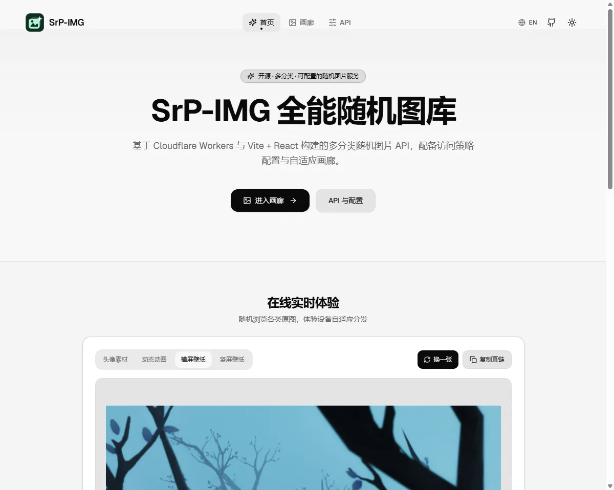
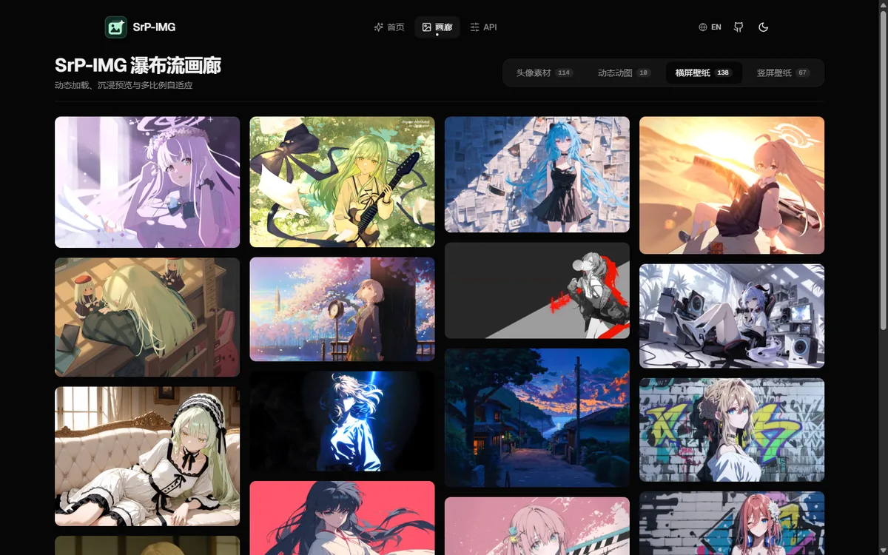
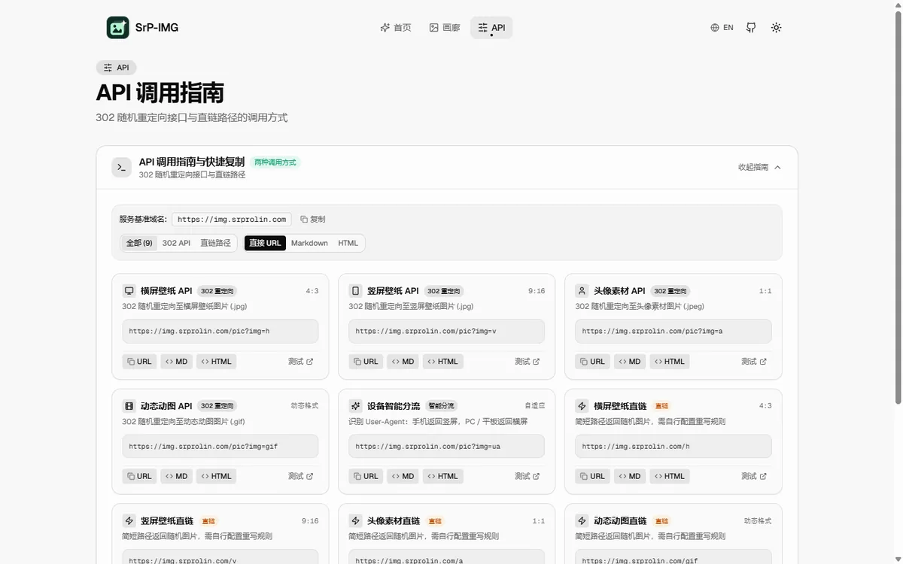
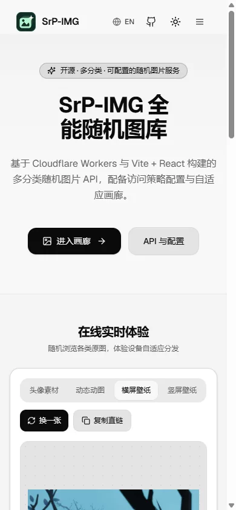

<h1 align="center">SrP-IMG — Random Image API & Gallery</h1>

<p align="center">
  <b>English</b> • <a href="./README_zh.md">简体中文</a>
</p>

<p align="center">
  <a href="https://github.com/RolinShmily/SrP-IMG/actions/workflows/deploy.yml"></a>
  <a href="https://github.com/RolinShmily/SrP-IMG/actions/workflows/ci.yml"></a>
  <a href="CHANGELOG.md"></a>
  <a href="LICENSE"></a>
  <a href="https://vite.dev"></a>
  <a href="https://react.dev"></a>
  <a href="https://workers.cloudflare.com"></a>
</p>

A lightweight, serverless multi-category random image API and visual gallery built on **Cloudflare Workers**. It uses Python pre-build hashing to distribute static images across deterministic random slots, offering low latency and zero maintenance.

### ✨ Core Features

* **Serverless Architecture**: Hosted on Cloudflare Workers — no dedicated servers or databases to maintain.
* **Fully Automated Multi-Category Support**: Supports `h` (landscape), `v` (portrait), `a` (avatars), `gif` (animated GIFs), and custom folders with zero frontend code modification.
* **Predictable Suffixes**: Each category advertises exactly one suffix (`.jpg` for `h/v`, `.jpeg` for `a`, `.gif` for `gif`, first source suffix for custom categories), so `/h/<hex>.jpg` stays guessable and the edge-rewrite rules can be static. Sources may still arrive as PNG/WebP; the Worker then serves the real media type from `worker/slot_formats.js` — see "Extension Strategy" and [`docs/reference/transform-rules.md`](./docs/reference/transform-rules.md).
* **Adaptive Waterfall Gallery**: Automatically derives categories, item counts, and aspect ratios from build metadata; supports English/Chinese i18n, dark/light themes, and Fancybox previews.
* **Three Access Modes**: server-side 302 redirection (`/pic?img=…`), Cloudflare Transform Rules edge rewrite (`/<category>`), and the gallery's direct slot links (`/<category>/<hex>.<ext>`).
* **Configurable Access Policy**: Referer and CORS allowlists are supplied as runtime environment variables, never baked into the code or committed to the repository.

---

### 📁 Directory Structure

```text
├── assets/
│   ├── original/           # [Core] Raw source images (organized by category folders)
│   │   ├── h/              # Landscape images (enforced .jpg)
│   │   ├── v/              # Portrait images (enforced .jpg)
│   │   ├── a/              # Avatar images
│   │   └── gif/            # Custom category (preserves .gif format)
│   ├── static/             # Hand-written files served from the site root
│   │   ├── _headers        # Cloudflare response headers
│   │   ├── icon.svg        # Site icon
│   │   ├── placeholder.svg # Broken-image fallback
│   │   └── fonts/          # Self-hosted Geist / Geist Mono latin subsets
│   ├── generated/          # Build artifact (git-ignored): counts.json + hex slots
│   │   └── h/, v/, a/, gif/
│   └── catalog.json        # Single source of truth for category labels & formats
├── src/                    # Vite + React application
│   ├── main.tsx            # Client entry (mounts the shared app)
│   ├── app.tsx             # Router, providers & route transition shell
│   ├── pages/              # Route components
│   │   ├── home.tsx        # Home showcase & live interactive demo
│   │   ├── gallery.tsx     # Dedicated waterfall gallery page
│   │   └── settings.tsx    # API reference (endpoints & copy formats)
│   ├── components/         # React UI components
│   │   ├── live-preview.tsx    # Live image preview container (zero-crop)
│   │   ├── image-gallery.tsx   # Core waterfall gallery component
│   │   └── api-panel.tsx       # API endpoint cards with URL / Markdown / HTML copy
│   ├── lib/                # Shared libraries & typed translations
│   │   ├── i18n.tsx        # Internationalization context & core strings
│   │   ├── api-translations.ts # API guide bilingual translations
│   │   └── gallery-translations.ts # Gallery bilingual translations
│   └── globals.css         # Tailwind v4 entry, theme tokens & self-hosted fonts
├── pipeline/               # Build-time pipeline package (only writer of assets/generated/counts.json)
│   ├── cli.py               # argparse + orchestration
│   ├── catalog.py           # Category registry loader (assets/catalog.json)
│   ├── scan.py              # Directory walk, size filter, per-category meta.json
│   ├── image_size.py        # Header-only dimension probe (JPEG/PNG/GIF/WebP)
│   ├── pool.py              # Slot mapping, copy or placeholder
│   ├── manifest.py          # counts.json writer + JSON Schema validation
│   └── worker_targets.py    # worker/targets.js data emitter (no logic)
├── contracts/              # Cross-layer contracts (manifest JSON Schema)
├── tests/                  # Automated test suite
│   ├── backend-contract.test.mjs   # Worker security & HTTP contract tests
│   ├── worker/source-equivalence.test.mjs # Differential HTTP matrix vs the pre-P2 build
│   ├── pipeline/test_pipeline.py   # Pipeline behaviour, slot naming, manifest contract
│   └── test_access_policy.py       # Runtime-policy env format & generated-data checks
├── index.html              # Vite entry: home route
├── gallery.html            # Vite entry: gallery route
├── settings.html           # Vite entry: settings route
├── vite.config.ts          # Multi-page build, @/ alias, generated-pool mounting
├── dist/                   # Build output (= `assets.directory` in wrangler.jsonc)
├── worker/                 # Hand-written runtime (imports generated data)
│   ├── index.js            # Cloudflare Workers entry
│   ├── policy.js           # Access-policy engine (env, CORS, Referer, headers)
│   └── targets.js          # Generated category data (do not edit)
├── .dev.vars.example       # Template for local Worker env bindings (policy)
├── wrangler.jsonc          # Cloudflare Workers configuration
├── docs/                   # Handbooks + product screenshots (start at docs/README.md)
│   ├── architecture/       # Layers, pipeline, runtime, data flows, decisions
│   ├── design/             # Tokens, components, motion, i18n & accessibility
│   ├── development/        # Commands, code style, testing, workflow
│   ├── reference/          # API, configuration, generated files, transform rules
│   └── screenshots/        # Screenshots used by the README preview section
├── README.md               # English documentation
└── README_zh.md            # Chinese documentation
```

---

### 🖥️ Preview



<details>
<summary>More screenshots — gallery, API reference, mobile</summary>







</details>

---

### 📚 Documentation

Four handbooks live under [`docs/`](./docs/README.md). New here? Read
[`development/README.md`](./docs/development/README.md) first, then
[`architecture/layers.md`](./docs/architecture/layers.md).

| Handbook | Answers |
| :--- | :--- |
| [architecture](./docs/architecture/README.md) | Why four layers, what owns each artifact, which orderings are byte contracts |
| [design](./docs/design/README.md) | Tokens, components, motion, i18n and accessibility |
| [development](./docs/development/README.md) | Commands, code style, the four test suites, PR/CI/release |
| [reference](./docs/reference/README.md) | API contract, configuration, generated files, edge rewrite |

### 🚀 Deployment Guide

#### 1. Material Preparation

Create category folders inside `assets/original/` in the project root:

* **Built-in Categories**: Place avatar images in `a/`, GIF animations in `gif/`, landscape images in `h/`, and portrait images in `v/`. Categories `h` and `v` enforce `.jpg` for universal API compatibility.
* **Custom Categories**: Create any folder such as `assets/original/wallpaper/` or `assets/original/anime/`. The prebuild engine automatically detects the folder and preserves the file extension of the first image.

#### 2. Build & Deployment Commands

The project includes convenient npm scripts for the workflow:

| Command | Description |
| :--- | :--- |
| `npm run gen` | Execute asset hash diffusion and data module generation (`python -m pipeline --hash-length 2`) |
| `npm run build:all` | One-click command to run pre-build generation and the Vite production build (`npm run gen && npm run build`) |
| `npm run deploy` | Execute Wrangler deployment to Cloudflare Worker (`wrangler deploy`) |
| `npm run dev` | Start the local Vite dev server (clean URLs such as `/gallery`) |
| `npm run build` | Build the multi-page Vite bundle into `dist/` |
| `npm run preview` | Serve the built `dist/` bundle locally |
| `npm test` | Run the pipeline, access-policy and Worker contract suites, plus the one-time differential matrix (it self-skips once the legacy entry point is gone) |

The build emits three HTML entry points (`index.html`, `gallery.html`, `settings.html`) that all mount the same React app; React Router resolves the pathname client-side. `dist/` matches the `assets.directory` in `wrangler.jsonc`, with no framework-specific prefix. `vite.config.ts` also mounts `assets/generated/` at the site root — the dev server serves `/counts.json` and `/<category>/<hex>.<ext>` straight from it, and the build copies it into `dist/`.

#### 3. Local Testing

To preview the gallery locally:

```bash
# Use --no-copy to quickly generate virtual metadata for testing without copying files
python -m pipeline --no-copy --hash-length 2
npm run dev
```

To test the random endpoint and access policy in the Cloudflare runtime, run `npm run build`, then `npx wrangler dev --local`, and open the URL Wrangler prints. On Windows, stop this local Wrangler process before rebuilding because it holds the `dist/` directory open. The Vite development server alone does not execute the Worker.

#### 4. Cloudflare Workers Production Build

Configure `wrangler.jsonc` (Workers + Static Assets is the only supported target;
the Pages adapter was removed):

```jsonc
{
  "name": "srp-img-worker",
  "main": "worker/index.js",
  "compatibility_date": "2026-01-05",
  "compatibility_flags": ["nodejs_compat"],
  "assets": {
    "directory": "./dist",
    "binding": "ASSETS",
    "run_worker_first": true
  }
}
```

*Note: Replace `name` with your Worker name, and set `compatibility_date` to your deployment date.*
Deploy command: `npm run deploy` (or `npx wrangler deploy`)

---

### 💡 Usage & Integration

#### Method A: Serverless API (JS Redirection)

Powered by `worker/index.js` (Workers: `/pic`). Configure the access policy below before embedding in external websites:

| Endpoint | Target / Behavior | Description |
| :--- | :--- | :--- |
| `/pic?img=a` | 302 Redirect to `/a/xxx.jpeg` | Random avatar image |
| `/pic?img=gif` | 302 Redirect to `/gif/xxx.gif` | Random GIF animation |
| `/pic?img=h` | 302 Redirect to `/h/xxx.jpg` | Random landscape image |
| `/pic?img=v` | 302 Redirect to `/v/xxx.jpg` | Random portrait image |
| `/pic?img=ua` | Smart UA-based redirection | Returns vertical for mobile, horizontal for desktop |

> **Custom Categories**: Place images in `assets/original/<custom-category>` (e.g., `assets/original/wallpaper`). The prebuild engine automatically extracts metadata and enables `?img=<custom-category>` out of the box without code modifications.

#### Method B: Visual Web Gallery

Visit your deployed root domain (e.g., `https://your-domain.pages.dev`):

* **Responsive Filtering**: Top navigation switches between `h`, `v`, `gif`, and custom categories.
* **Waterfall Masonry**: High-performance lazy loading powered by React.
* **Immersive Preview**: Integrated Fancybox with zoom, rotate, fullscreen, and download capabilities.

#### Method C: Edge URL Rewrite (Transparent Mode)

Optional **Transform Rules** make `/<category>` resolve straight to a random slot
with no redirect. They coexist with the Worker API (`/pic?img=…`) and with the
gallery's direct slot links — all three entry points end at the same asset, with
the same access policy and the same corrected `Content-Type`.

Create one **Rewrite URL** rule per category (*replace `<your-domain>`*). The match must be an **exact path**: `eq` works on every plan, while `matches`
requires Business / WAF Advanced, `starts_with` once swallowed the bundle under
`/assets/…`, and an extension-based guard locks the zone to a single suffix. Both pitfalls are
explained in [`docs/reference/transform-rules.md`](./docs/reference/transform-rules.md).

| Category | Match expression | Rewrite path (dynamic) |
| :--- | :--- | :--- |
| `h` | `(http.host eq "<your-domain>" and http.request.uri.path eq "/h")` | `concat("/h/", substring(uuidv4(cf.random_seed), 0, 2), ".jpg")` |
| `v` | `(http.host eq "<your-domain>" and http.request.uri.path eq "/v")` | `concat("/v/", substring(uuidv4(cf.random_seed), 0, 2), ".jpg")` |
| `a` | `(http.host eq "<your-domain>" and http.request.uri.path eq "/a")` | `concat("/a/", substring(uuidv4(cf.random_seed), 0, 2), ".jpeg")` |
| `gif` | `(http.host eq "<your-domain>" and http.request.uri.path eq "/gif")` | `concat("/gif/", substring(uuidv4(cf.random_seed), 0, 2), ".gif")` |

> **Notes**
> * `matches` needs a Business / WAF Advanced plan; the examples use `eq`, which works on every plan. Never use `starts_with("/a")` — it matches every path that starts with `/a` (it once blanked the site by swallowing `/assets/…`).
> * The suffix in each rewrite expression must equal that category's `ext_policy` in `assets/catalog.json`.
> * The substring length must equal `--hash-length` (`2` → `0, 2`, i.e. 256 slots).
> * `assets.run_worker_first: true` must stay enabled — the rewritten request still goes through the Worker, which applies the access policy and corrects `Content-Type`.
> * After the rewrite, `/h` becomes `/h/ab.jpg` and no longer matches `^/h/?$`, so the rule cannot recurse. The address bar still shows `/h`.
> * Example: `https://your-domain.pages.dev/h`

---

### 🛡️ Access policy

The allowlist is runtime configuration, not build input. `worker/policy.js` is
hand-written source without any hostname and reads its policy from the Worker
environment on every request, so neither the repository,
the build artifact, nor the deployed bundle contains your domains. Deploy as
usual, then set the values — Cloudflare stores them encrypted and the next
request picks them up, with no rebuild:

```bash
npx wrangler secret put REFERER_ALLOWED_HOSTS
```

[`.dev.vars.example`](./.dev.vars.example) documents every supported variable,
the list/boolean syntax, and the defaults; it is also the file `wrangler dev`
reads locally. Nothing about the policy is rendered by the site itself: rule
names, syntax, and defaults live only in that file and in the Worker source.

A request rejected by the policy is answered exactly like a missing image, and a
misconfiguration is logged rather than described to the caller, so responses
cannot be used to map the rules. Header checks are not authentication: see
[SECURITY.md](SECURITY.md) for that boundary.

Run every deterministic suite (pipeline, access policy, HTTP contract) without
regenerating the repository image pool:

```bash
npm test
# or one suite at a time
node --test tests/backend-contract.test.mjs
node --test tests/worker/source-equivalence.test.mjs
python tests/pipeline/test_pipeline.py
python tests/test_access_policy.py
```

---

### ⚙️ Technical Details

#### Build Engine: `pipeline/`

When executed as `python -m pipeline`, it performs:

1. **Hash Expansion**: Uses `--hash-length` to define the random pool size. For length `3`, each category generates $16^3 = 4096$ paths.
2. **Extension Strategy**:
   * Inspects each subdirectory under `assets/original`.
   * If named `h` or `v`, enforces the CLI extension (defaults to `.jpg`).
   * Otherwise, auto-detects the extension from the first image in that directory.
3. **Metadata Export**: Generates `counts.json` containing total image counts (`counts`) and extension mappings (`category_exts`).
4. **Format Guard**: The suffix is a routing contract, not an encoding claim. A PNG or WebP source in `h`/`v`/`a` is copied verbatim into a `.jpg`/`.jpeg` slot, so the suffix and the bytes disagree (56/114 in `a`, 43/138 in `h`, 7/67 in `v`). Renaming a slot would change its URL, so the pool keeps the suffix: the pipeline writes one format code per slot into `worker/slot_formats.js`, and the Worker overwrites `Content-Type` from that table for both protected and unprotected image responses (`/a/01.jpeg` is really WebP and is served as `image/webp`). This requires `assets.run_worker_first: true`; requests that bypass the Worker (for example asset-first routing) keep the suffix-derived header. Each run prints one line per affected category, `--strict-formats` aborts with exit code 1 before anything is written, and a test pins the real mismatch counts so the fix cannot silently rot. Switching a category's `ext_policy` to `"source"` only takes the *first* source's suffix for the whole category, so it clears the drift only for suffix-homogeneous categories (`gif`) while changing that category's URLs and requiring a pool regeneration. Making the files on disk honest too would need transcoding or per-slot suffixes (new URLs); that is deliberately not done.

---

### 📦 Storage & Capacity Management

Because CI platforms enforce limits on file counts and total artifact sizes, this project includes an **automatic size circuit-breaker**:

#### 1. File Size Threshold

* **5MB Limit**: `python -m pipeline` scans each source file during the build phase.
* **Policy**: Any single file exceeding **5MB** is skipped entirely. It will not be copied or included in the hash iteration.
* **Purpose**: Prevents oversized GIFs or raw photos from exhausting disk space during exponential expansion ($16^3 = 4096\times$).

#### 2. Capacity Formula

Estimate total disk consumption using the formula:

$$
S_{total} = \sum_{c=1}^{n} (16^L \times \bar{S}_c)
$$

* $S_{total}$: Total disk space consumed after build.
* $L$: Specified `hash-length` (default: 2).
* $\bar{S}_c$: Average size of valid images ($\le 5\text{MB}$) in category $c$.
* $n$: Total number of category folders.

> *Example*: If category `h` contains 10 images averaging 500KB each, with `hash-length 3`:
> Space $= 16^3 \times 500\text{KB} = 4096 \times 0.5\text{MB} \approx 2\text{GB}$.

#### 3. Best Practices

* **Image Compression**: We recommend compressing images and GIFs below 2MB before placing them in `assets/original` (e.g. using [Caesium Image Compressor](https://saerasoft.com/caesium/)).
* **Adjust Hash Length**: For large image libraries, set `--hash-length` to `2` (generates 256 images per category) to ensure build success.
* **Build Logs**: Cloudflare build logs will display warnings: `[category] Ignored X files exceeding 5.0MB`.

---

### 🎨 Category Extension

The gallery, home page, and API configuration panel are dynamically driven by `counts.json`. To add a new category:

1. Create a new category subfolder under `assets/original/` and place your images inside.
2. Run the build (`npm run build:all`) or push code to trigger automated deployment.
3. The build script automatically detects image dimensions, file extensions, and emits updated metadata. The entire frontend updates automatically with **zero code modifications**.

---

### 🤝 Contributing & Security

Contributions are welcome — see [CONTRIBUTING.md](CONTRIBUTING.md) for local setup, image
requirements and PR guidelines, and [CODE_OF_CONDUCT.md](CODE_OF_CONDUCT.md) for how we treat
each other. Notable changes are recorded in [CHANGELOG.md](CHANGELOG.md).

To report a vulnerability, follow [SECURITY.md](SECURITY.md) rather than opening a public issue.

---

### 📜 License

This project's **source code** is licensed under the **MIT License** — see [LICENSE](LICENSE) for the full text. The license does **not** extend to the image assets, as set out below.

#### Image Sources & Copyright

**The MIT license in this repository covers source code only** (`.ts` / `.tsx` / `.js` / `.py` and configuration files). It does **not** cover `assets/original/` or any image asset in the build output.

* Images under `assets/original/` were collected from the internet. Copyright belongs to **their respective authors**, and they are included solely for personal study, functional demonstration and technical validation.
* This repository claims no rights over these images and holds no explicit permission from their authors.
* Because the repository owner holds no rights in these images, the MIT license here **does not — and cannot — grant anyone** the right to reuse them. For any commercial use or public redistribution, clear the rights with the original author yourself.
* If you own the rights to an image and would rather it were not here, please open an [Issue](https://github.com/RolinShmily/SrP-IMG/issues) and it will be removed as soon as the claim is confirmed.

> **Note to deployers**: replace `assets/original/` with your own images, or with a source whose terms you have verified — such as Unsplash, Pexels or Pixabay — and comply with that source's license.

#### Acknowledgements & Inspirations

This project was designed with reference to the following projects. Only their public
interface design and general approach were consulted — none of their source code was
copied, and the implementation here is independently written:

1. **[EdgeOne_Function_PicAPI](https://github.com/afoim/EdgeOne_Function_PicAPI)** by [@afoim](https://github.com/afoim) — Design reference for the EdgeOne / Cloudflare Functions serverless random-image redirection API. Licensed under **AGPL-3.0**; this project does not include its code.
2. **[cf-rule-random-url](https://github.com/afoim/cf-rule-random-url)** by [@afoim](https://github.com/afoim)
   Inspiration for Cloudflare Transform Rules URL rewriting logic and hex hash generation approach.
