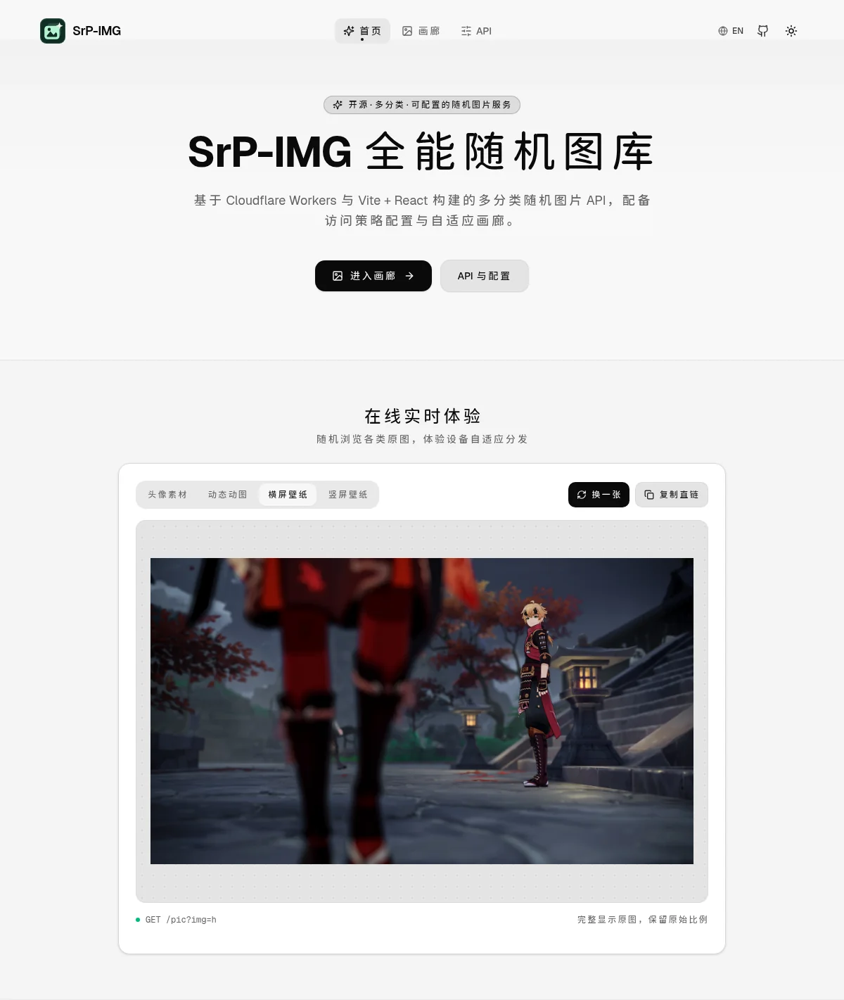
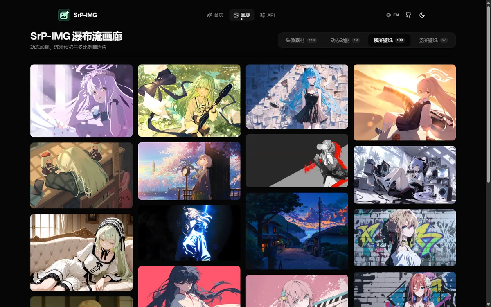
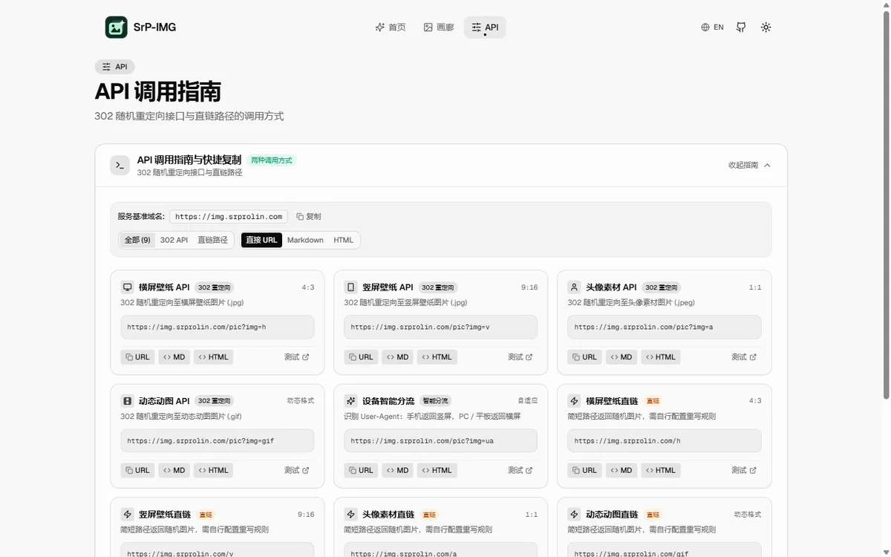
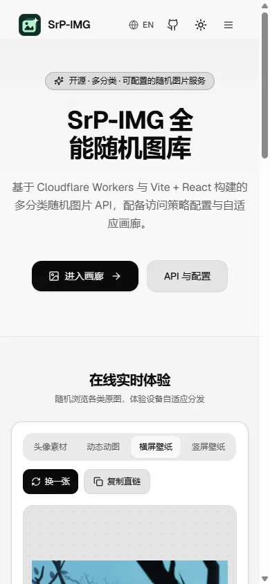

<h1 align="center">SrP-IMG — Random Image API & Gallery</h1>

<p align="center">
  <b>English</b> | <a href="./README.zh-CN.md">简体中文</a>
</p>

<p align="center">
  <a href="https://github.com/RolinShmily/SrP-IMG/actions/workflows/deploy.yml"></a>
  <a href="https://github.com/RolinShmily/SrP-IMG/actions/workflows/test.yml"></a>
  <a href="LICENSE"></a>
  <a href="https://vite.dev"></a>
  <a href="https://react.dev"></a>
  <a href="https://workers.cloudflare.com"></a>
</p>

<p align="center">
  
</p>

<details>
<summary>More screenshots — gallery, API reference, mobile</summary>







</details>

**SrP-IMG** is a serverless multi-category random image API and adaptive waterfall gallery built on **Cloudflare Workers** + **Vite / React**. A Python build pipeline hashes your source images into deterministic static slots, giving you fast random redirects, optional edge URL rewrites, runtime Referer/CORS protection, and a zero-config bilingual gallery.

## Usage

### 1. Random Image API (302 Redirect)

| Endpoint | Behavior | Description |
| :--- | :--- | :--- |
| `/pic?img=h` | `302` → `/h/<hex>.jpg` | Random landscape image |
| `/pic?img=v` | `302` → `/v/<hex>.jpg` | Random portrait image |
| `/pic?img=a` | `302` → `/a/<hex>.jpeg` | Random avatar image |
| `/pic?img=gif` | `302` → `/gif/<hex>.gif` | Random GIF animation |
| `/pic?img=ua` | Smart UA routing | Portrait on mobile, landscape on desktop |
| `/pic?img=<custom>` | `302` → `/<custom>/<hex>.<ext>` | Any custom folder under `assets/original/` |

### 2. Web Gallery & Direct Links

Open your deployed domain to browse categories in an adaptive masonry gallery with Fancybox lightbox, dark/light themes, Chinese/English UI, and one-click URL / Markdown / HTML copy (`/settings`).

### 3. Edge URL Rewrite (Optional)

You can add Cloudflare **Transform Rules** so `/h`, `/v`, `/a`, or `/gif` directly returns a random image without a `302` redirect. See [`docs/reference.md`](docs/reference.md#4-边缘重写cloudflare-transform-rules) for exact expressions and pitfalls.

## Deployment

Requirements: **Node.js 22+**, **Python 3.8+**, and a Cloudflare Workers account.

### 1. Prepare Images

Put your images in category folders under `assets/original/` (single files over **5 MB** are automatically skipped; compressing below 2 MB is recommended):

```text
assets/original/
├── h/          # Landscape (.jpg slots)
├── v/          # Portrait (.jpg slots)
├── a/          # Avatars (.jpeg slots)
├── gif/        # Animated GIFs (.gif slots)
└── <custom>/   # Any extra category — auto-detected by build & frontend
```

### 2. Build & Deploy

```bash
npm ci --ignore-scripts
npm run build:all          # runs python -m pipeline --hash-length 2 && vite build
```

Update `name`, `compatibility_date`, and `routes` in `wrangler.jsonc` (keep `assets.run_worker_first: true`), then deploy:

```bash
npm run deploy             # npx wrangler deploy
```

For automated deployments via GitHub Actions (`.github/workflows/deploy.yml`), set `CLOUDFLARE_API_TOKEN` and `CLOUDFLARE_ACCOUNT_ID` in your repository secrets.

### 3. Local Preview

```bash
npm run dev                # Vite dev server (gallery & UI)
npx wrangler dev --local   # Full Worker runtime + access policy (after npm run build)
```

### 4. Access Policy (Optional)

Referer and CORS allowlists are runtime Worker secrets — never hardcoded or committed:

```bash
npx wrangler secret put REFERER_ALLOWED_HOSTS
npx wrangler secret put CORS_ALLOWED_ORIGINS
```

See [`.dev.vars.example`](./.dev.vars.example) and [`docs/reference.md`](docs/reference.md) for all variables and defaults.

## Documentation

| Document | Scope |
| :--- | :--- |
| [`docs/architecture.md`](docs/architecture.md) | Layers, ownership, build pipeline, Worker runtime, data flows & ADRs |
| [`docs/design.md`](docs/design.md) | Design tokens, components, motion, i18n, accessibility & screenshots |
| [`docs/development.md`](docs/development.md) | Commands, code style, test suites & GitHub Actions workflows |
| [`docs/reference.md`](docs/reference.md) | HTTP API contract, configuration, generated files & Transform Rules |

Also see [`CONTRIBUTING.md`](CONTRIBUTING.md).

## License & Credits

* **Source code** is licensed under the **MIT License** — see [`LICENSE`](LICENSE).
* **Image assets** under `assets/original/` are **not** covered by MIT. They were collected from the internet for study and demonstration only; copyright belongs to their respective authors. Replace `assets/original/` with your own or properly licensed images before deploying. If you own an image and want it removed, please open an [Issue](https://github.com/RolinShmily/SrP-IMG/issues).
* **Inspirations**: interface design and edge-rewrite concepts were inspired by [EdgeOne_Function_PicAPI](https://github.com/afoim/EdgeOne_Function_PicAPI) and [cf-rule-random-url](https://github.com/afoim/cf-rule-random-url) by [@afoim](https://github.com/afoim) (independent implementation; no code copied).
