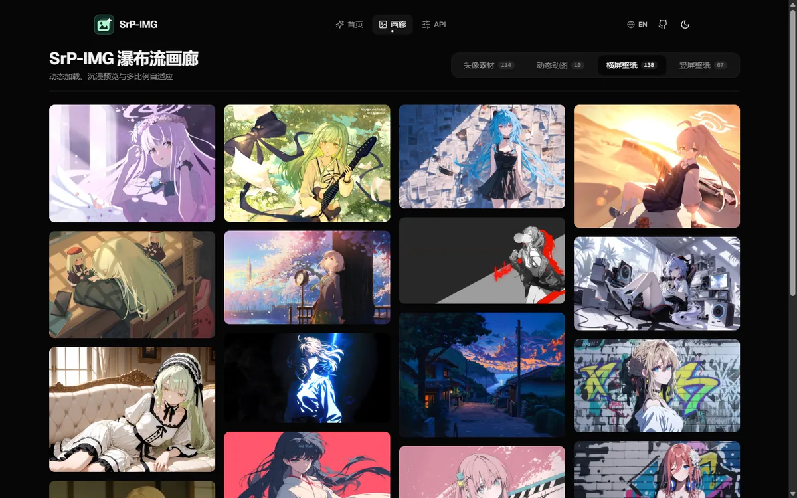
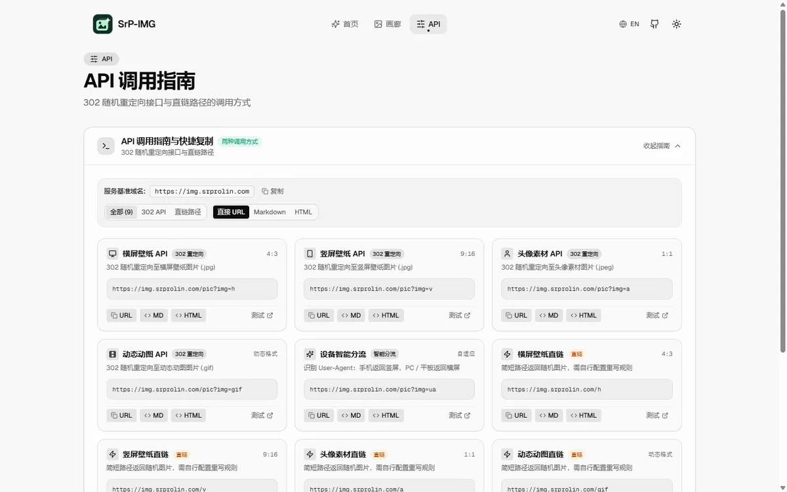
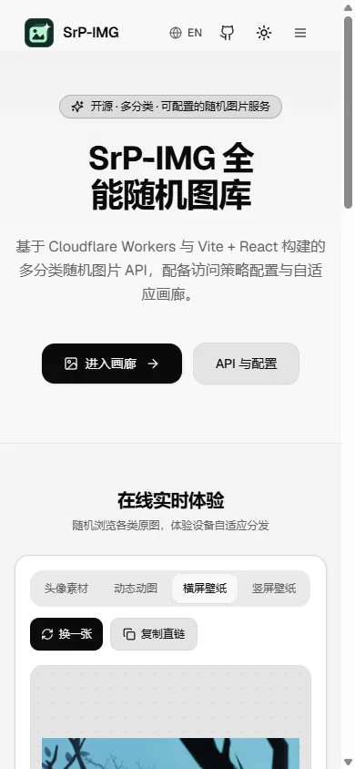

<h1 align="center">SrP-IMG — 随机图片 API & 画廊</h1>

<p align="center">
  <a href="./README.md">English</a> | <b>简体中文</b>
</p>

<p align="center">
  <a href="https://github.com/RolinShmily/SrP-IMG/actions/workflows/deploy.yml"></a>
  <a href="https://github.com/RolinShmily/SrP-IMG/actions/workflows/test.yml"></a>
  <a href="LICENSE"></a>
  <a href="https://vite.dev"></a>
  <a href="https://react.dev"></a>
  <a href="https://workers.cloudflare.com"></a>
</p>

<p align="center">
  
</p>

<details>
<summary>更多截图 —— 画廊、API 参考、移动端</summary>







</details>

**SrP-IMG** 是基于 **Cloudflare Workers** + **Vite / React** 构建的无服务器多分类随机图片 API 与自适应瀑布流画廊。通过 Python 离线预构建将静态素材扩散为确定性槽位，开箱支持 302 随机跳转、可选边缘无感重写、运行时防盗链/CORS 策略以及中英双语画廊。

## 使用方式

### 1. 随机图片 API（302 重定向）

| 接口 | 行为 | 说明 |
| :--- | :--- | :--- |
| `/pic?img=h` | `302` → `/h/<hex>.jpg` | 随机横屏图 |
| `/pic?img=v` | `302` → `/v/<hex>.jpg` | 随机竖屏图 |
| `/pic?img=a` | `302` → `/a/<hex>.jpeg` | 随机头像 |
| `/pic?img=gif` | `302` → `/gif/<hex>.gif` | 随机 GIF 动图 |
| `/pic?img=ua` | UA 智能分流 | 移动端返回竖屏，桌面端返回横屏 |
| `/pic?img=<自定义分类>` | `302` → `/<分类>/<hex>.<ext>` | 放入 `assets/original/` 自动生效 |

### 2. 可视化画廊与直链

访问部署后的站点即可按分类浏览自适应瀑布流画廊，支持 Fancybox 灯箱预览、深浅主题与中英切换，并在 `/settings` 页面一键复制 URL / Markdown / HTML 调用代码。

### 3. 边缘 URL 重写（可选）

可在 Cloudflare **Transform Rules** 中配置精确匹配规则，让 `/h`、`/v`、`/a`、`/gif` 直接返回随机图片而无需 302 跳转。规则表达式与注意事项见 [`docs/reference.md`](docs/reference.md#4-边缘重写cloudflare-transform-rules)。

## 快速部署

环境要求：**Node.js 22+**、**Python 3.8+** 及 Cloudflare Workers 账号。

### 1. 准备素材

在 `assets/original/` 下按分类放置图片（单文件超过 **5 MB** 会自动跳过，建议压缩至 2 MB 以内）：

```text
assets/original/
├── h/            # 横屏图（输出 .jpg 槽位）
├── v/            # 竖屏图（输出 .jpg 槽位）
├── a/            # 头像（输出 .jpeg 槽位）
├── gif/          # 动图（输出 .gif 槽位）
└── <自定义分类>/  # 新增目录自动被构建与前端感知，无需改代码
```

### 2. 构建与部署

```bash
npm ci --ignore-scripts
npm run build:all          # 执行 python -m pipeline --hash-length 2 && vite build
```

按需修改 `wrangler.jsonc` 中的 `name`、`compatibility_date` 与 `routes`（保持 `assets.run_worker_first: true`），执行部署：

```bash
npm run deploy             # npx wrangler deploy
```

如需通过 GitHub Actions（`.github/workflows/deploy.yml`）自动部署，在仓库 Secrets 中配置 `CLOUDFLARE_API_TOKEN` 与 `CLOUDFLARE_ACCOUNT_ID` 即可。

### 3. 本地预览

```bash
npm run dev                # 启动 Vite 开发服务（预览画廊与页面）
npx wrangler dev --local   # 本地验证 Worker 随机接口与访问策略（需先 npm run build）
```

### 4. 访问策略（可选）

Referer 与 CORS 白名单通过 Worker 运行时环境变量下发，不会写入源码或提交到仓库：

```bash
npx wrangler secret put REFERER_ALLOWED_HOSTS
npx wrangler secret put CORS_ALLOWED_ORIGINS
```

完整变量说明与默认值见 [`.dev.vars.example`](./.dev.vars.example) 与 [`docs/reference.md`](docs/reference.md)。

## 文档

| 文档 | 内容 |
| :--- | :--- |
| [`docs/architecture.md`](docs/architecture.md) | 四层边界、构建管线、Worker 运行时、主链路与架构决策 |
| [`docs/design.md`](docs/design.md) | 设计 token、组件规范、动效、双语可达性与截图说明 |
| [`docs/development.md`](docs/development.md) | 开发命令、代码风格、测试套件与 Actions 工作流 |
| [`docs/reference.md`](docs/reference.md) | API 契约、配置项、生成物格式与 Transform Rules 规则 |

参与贡献见 [`CONTRIBUTING.md`](CONTRIBUTING.md)。

## 开源协议与致谢

* **源代码**基于 **MIT 协议** 开源，详见 [`LICENSE`](LICENSE)。
* **图片素材声明**：MIT 协议**不覆盖** `assets/original/` 及构建产物中的图片资源。仓库自带图片收集自互联网，仅用于学习与功能演示，版权归各自原作者所有。部署时请替换为自有图片或明确授权图源；若您是版权方并希望移除某张图片，请提交 [Issue](https://github.com/RolinShmily/SrP-IMG/issues)。
* **致谢**：接口与边缘重写思路参考了 [@afoim](https://github.com/afoim) 的 [EdgeOne_Function_PicAPI](https://github.com/afoim/EdgeOne_Function_PicAPI) 与 [cf-rule-random-url](https://github.com/afoim/cf-rule-random-url)（独立实现，未复制其代码）。
