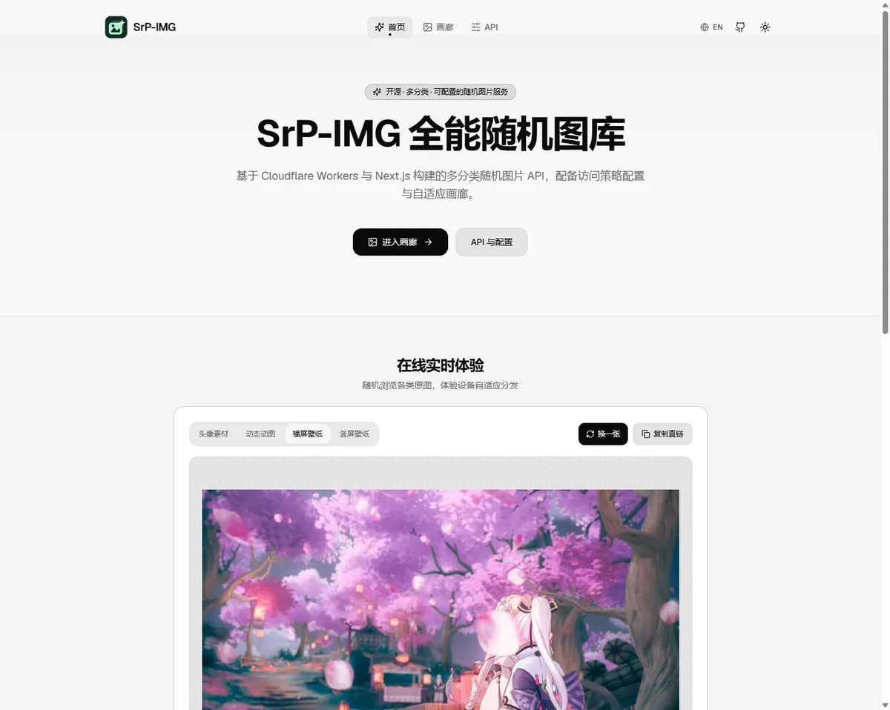
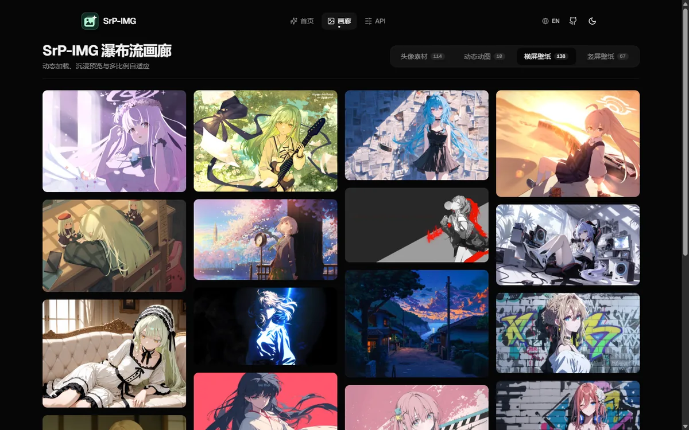
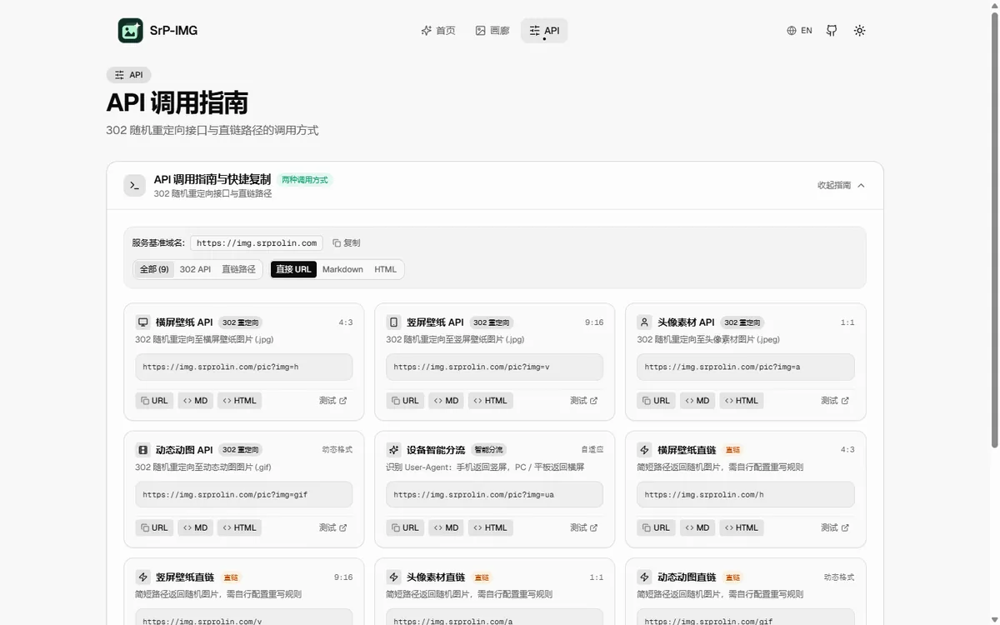
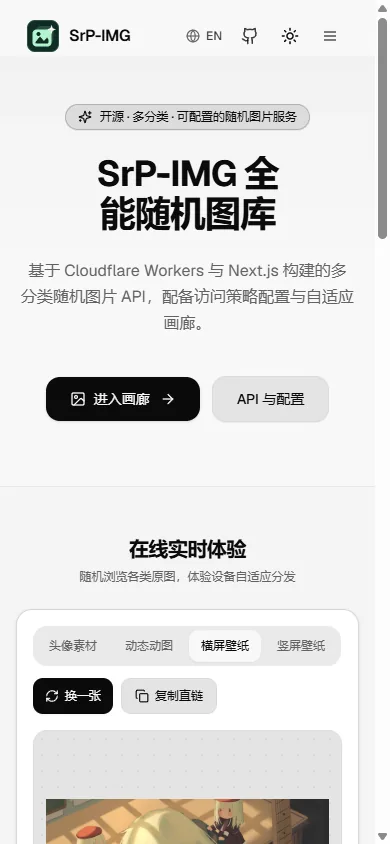

<h1 align="center">SrP-IMG — 随机图片 API & 画廊</h1>

<p align="center">
  <a href="./README.md">English</a> • <b>简体中文</b>
</p>

<p align="center">
  <a href="https://github.com/RolinShmily/SrP-IMG/actions/workflows/deploy.yml"></a>
  <a href="https://github.com/RolinShmily/SrP-IMG/actions/workflows/ci.yml"></a>
  <a href="CHANGELOG.zh.md"></a>
  <a href="LICENSE"></a>
  <a href="https://nextjs.org"></a>
  <a href="https://workers.cloudflare.com"></a>
</p>

基于 **Cloudflare Workers / Pages** 构建的轻量级无服务器多分类随机图片 API 与画廊系统。利用 Python 离线预构建技术将静态素材散列为随机访问槽位，兼顾边缘快速响应与免维护特性。

### ✨ 核心特性

* **无服务器架构**：托管于 Cloudflare Workers / Pages，无需自建传统服务器，无需数据库。
* **多分类全自动联动**：支持 `h` (横屏)、`v` (竖屏)、`a` (头像)、`gif` (动图) 以及自定义分类，前端全流程动态感知，后续扩充素材目录无需修改前端代码。
* **格式自动适配**：`h/v` 统一规范为 `.jpg` 保证通用兼容性，其余分类自动嗅探并保留原图扩展名（如 `.gif`, `.jpeg`, `.png`）。
* **自适应瀑布流画廊**：前端自动根据元数据适配分类数量与比例，支持中英双语切换、深浅主题与 Fancybox 交互预览。
* **双模式调用**：支持通用 302 服务端重定向（API 模式）与 Cloudflare Transform Rules 边缘重写（无感模式）。
* **可配置访问策略**：Referer 与 CORS 白名单以运行时环境变量下发，不写进代码，也不提交到仓库。

---

### 📁 目录结构

```text
├── oriImg/                 # [核心] 原始素材目录（按分类子文件夹组织）
│   ├── h/                  # 横屏图片素材（强转为 .jpg）
│   ├── v/                  # 竖屏图片素材（强转为 .jpg）
│   ├── a/                  # 头像图片素材
│   └── gif/                # 自定义分类（自动保留 .gif 后缀）
├── public/                 # 静态资源与构建产物目录
│   ├── counts.json         # 自动生成的全站索引与元数据
│   └── h/、v/、a/、gif/     # 映射后的十六进制图片集合
├── functions/              # Cloudflare Pages Functions
│   └── pic.js              # 服务端随机重定向接口（Pages）
├── app/                    # Next.js App Router
│   ├── page.tsx            # 首页全景与实时体验
│   ├── gallery/            # 独立瀑布流画廊页面
│   ├── settings/           # API 参考（接口与复制格式）
│   ├── template.tsx        # 客户端路由切换进入过渡容器
│   └── layout.tsx          # 根布局与元数据配置
├── components/             # React UI 组件
│   ├── live-preview.tsx    # 实时原图自适应预览容器（零裁切）
│   ├── image-gallery.tsx   # 核心瀑布流画廊组件
│   └── api-panel.tsx       # 接口卡片与 URL / Markdown / HTML 复制
├── lib/                    # 共享模块与类型化国际化字典
│   ├── i18n.tsx            # 国际化上下文与全局文案
│   ├── api-translations.ts # API 指南双语翻译字典
│   └── gallery-translations.ts # 画廊双语翻译字典
├── scripts/                # 构建辅助脚本
│   └── normalize-static-export.mjs # Next 16 静态导出片段路径规范化工具
├── tests/                  # 自动化回归测试套件
│   ├── backend-contract.test.mjs   # Worker / Pages 安全与 HTTP 契约测试
│   ├── static-export.test.mjs      # 静态导出片段路径回归测试
│   └── test_access_policy.py       # 运行时策略环境变量与生成器检查
├── gen_img.py              # 构建脚本：素材扫描、哈希映射与元数据生成
├── .dev.vars.example       # 本地 Worker 环境变量模板（访问策略）
├── index.js                # Cloudflare Workers 入口
├── wrangler.jsonc          # Cloudflare Workers 配置文件
├── docs/screenshots/       # README 预览章节使用的截图
├── README.md               # 英文说明文档
└── README_zh.md            # 中文说明文档
```

---

### 🖥️ 前端预览



<details>
<summary>更多截图 —— 画廊、API 参考、移动端</summary>







</details>

---

### 🚀 部署指南

#### 1. 素材准备

在根目录 `oriImg/` 下创建分类文件夹：

* **预设分类**：`a/`（头像）、`gif/`（动图）、`h/`（横屏）与 `v/`（竖屏）。其中 `h` 与 `v` 输出时会统一固定为 `.jpg`，确保兼容所有 API 客户端。
* **自定义分类**：创建如 `oriImg/wallpaper/` 或 `oriImg/anime/` 等任意目录。脚本会自动取该目录首张图片的后缀作为该分类的输出后缀。

#### 2. 构建与部署命令

项目内置了便捷的 npm scripts 命令流：

| 命令 | 说明 |
| :--- | :--- |
| `npm run gen` | 执行素材哈希扩散与接口入口生成 (`python gen_img.py --hash-length 2`) |
| `npm run build:all` | 一键完成预构建与 Next.js 静态打包 (`npm run gen && npm run build`) |
| `npm run deploy` | 执行 Wrangler 部署至 Cloudflare Worker (`wrangler deploy`) |
| `npm run dev` | 启动本地 Next.js 开发调试服务 |
| `npm run build` | 执行 Next.js 静态编译与导出 (`out/`) |

`npm run build` 还会修正 Next.js 16 在 Windows 上导出的路由片段文件名，保证静态部署的路由预取请求正常；Linux 导出保持原样。

#### 3. 本地测试

如果您想在本地预览画廊效果，请执行：

```bash
# 使用 --no-copy 快速生成虚拟元数据进行测试（不复制实际图片）
python gen_img.py --no-copy --hash-length 2
npm run dev
```

要在 Cloudflare 运行时验证随机接口与访问策略，请先执行 `npm run build`，再运行 `npx wrangler dev --local`，打开 Wrangler 显示的地址。Windows 下重新构建前需停止该本地 Wrangler 进程，因为它会占用 `out/` 目录。仅运行 Next.js 开发服务不会执行 Worker。

#### 4. Cloudflare Pages / Workers 生产构建

在 Cloudflare Pages 仪表板配置如下：

* **框架预设**：`Next.js`
* **构建命令**：`npm run build:all`（或 `python3 gen_img.py --hash-length 2 && npm run build`）
* **输出目录**：`out`
* **环境变量**：确保 Python 环境为 3.8+

如果使用 **Cloudflare Workers**，配置根目录的 `wrangler.jsonc`：

```jsonc
{
  "name": "srp-img-worker",
  "main": "index.js",
  "compatibility_date": "2026-01-05",
  "compatibility_flags": ["nodejs_compat"],
  "assets": {
    "directory": "./out",
    "binding": "ASSETS",
    "run_worker_first": true
  }
}
```

*注意：请将 `name` 改为你要部署的 Worker 名称；将 `compatibility_date` 改为你的部署日期。*
部署命令：`npm run deploy`（或 `npx wrangler deploy`）

---

### 💡 使用方式

#### 方式 A：服务端 API (JS 重定向)

由生成的 `functions/pic.js`（Pages：`/pic`）或 `index.js`（Workers：`/pic` 与 `/api/pic`）提供支持；外部网页引用前请配置下文的访问策略：

| 功能描述 | 调用地址 | 返回结果 |
| :--- | :--- | :--- |
| **随机头像** | `/pic?img=a` | 302 重定向至 `/a/xxx.jpeg` |
| **随机 GIF 动图** | `/pic?img=gif` | 302 重定向至 `/gif/xxx.gif` |
| **随机横图** | `/pic?img=h` | 302 重定向至 `/h/xxx.jpg` |
| **随机竖图** | `/pic?img=v` | 302 重定向至 `/v/xxx.jpg` |
| **UA 智能分流** | `/pic?img=ua` | 手机端返回竖图，电脑端返回横图 |

> **自定义分类支持**：用户在 `oriImg/<自定义分类名>`（例如 `oriImg/wallpaper`）放置图片后，预构建会自动支持 `?img=<自定义分类名>`，无需手动修改重定向逻辑代码。

#### 方式 B：前端可视化画廊

访问部署后的根域名（如 `https://your-domain.pages.dev`）：

* **自动适配**：顶部导航会自动切换 `h`、`v`、`gif` 等分类。
* **瀑布流展示**：基于 Next.js 的高性能瀑布流动态加载。
* **沉浸式预览**：集成 Fancybox，支持缩放、旋转、全屏及一键下载。

#### 方式 C：URL 重写 (无感随机)

需在 Cloudflare 仪表板手动配置 **Transform Rules**（*请将下列表达式中的 `<your-domain>` 替换为实际域名*）：

**规则一：横竖屏分类 (`h` / `v`)**

1. **匹配表达式**：

```text
(http.host eq "<your-domain>" and starts_with(http.request.uri.path, "/h") and not ends_with(http.request.uri.path, ".jpg")) or (http.host eq "<your-domain>" and starts_with(http.request.uri.path, "/v") and not ends_with(http.request.uri.path, ".jpg"))
```

2. **路径重写至 (Dynamic)**：

```text
concat(http.request.uri.path, "/", substring(uuidv4(cf.random_seed), 0, 2), ".jpg")
```

**规则二：头像分类 (`a`)**

1. **匹配表达式**：

```text
(http.host eq "<your-domain>" and starts_with(http.request.uri.path, "/a") and not ends_with(http.request.uri.path, ".jpeg"))
```

2. **路径重写至 (Dynamic)**：

```text
concat(http.request.uri.path, "/", substring(uuidv4(cf.random_seed), 0, 2), ".jpeg")
```

**规则三：GIF 分类 (`gif`)**

1. **匹配表达式**：

```text
(http.host eq "<your-domain>" and starts_with(http.request.uri.path, "/gif") and not ends_with(http.request.uri.path, ".gif"))
```

2. **路径重写至 (Dynamic)**：

```text
concat(http.request.uri.path, "/", substring(uuidv4(cf.random_seed), 0, 2), ".gif")
```

> **注意**：如果构建命令中 `--hash-length` 值为 `3`，则此处 `cf.random_seed` 截取长度右边界也需从 `2` 改为 `3`。
> 访问示例：`https://your-domain.pages.dev/h`

---

### 🛡️ 访问策略

白名单是运行时配置，不是构建输入。`index.js` 与 `functions/pic.js` 生成时不包含任何域名，
请求到来时才从 Worker / Pages 的环境变量读取。因此仓库、构建产物与已部署的 bundle 里都不会
出现你的域名。照常部署，然后写入变量即可——Cloudflare 加密保存，下一次请求立即生效，无需重建：

```bash
npx wrangler secret put REFERER_ALLOWED_HOSTS
```

[`.dev.vars.example`](./.dev.vars.example) 记录了全部可用变量、列表与布尔的写法以及默认值，
它同时也是 `wrangler dev` 本地读取的文件。站点本身不渲染任何策略内容：规则名、写法与默认值
只存在于该文件和后端源码里。

被策略拒绝的请求与不存在的图片返回完全相同的响应，配置错误只写日志、不回给调用方，
因此无法用响应差异反推规则。请求头检查不等于身份认证：该边界以及 Workers / Pages 的差异见
[SECURITY.zh.md](SECURITY.zh.md)。

无需安装依赖或覆盖仓库图片池，即可运行后端契约测试：

```bash
node --test tests/backend-contract.test.mjs
python -m unittest discover -s tests -p test_access_policy.py -v
```

---

### ⚙️ 技术参数细节

#### 关于 `gen_img.py`

脚本执行时会进行以下操作：

1. **哈希扩散**：通过 `--hash-length` 指定随机空间。若设为 `3`，每个分类会生成 $16^3 = 4096$ 个访问路径。
2. **后缀策略**：
   * 扫描 `oriImg` 下的所有子目录。
   * 若目录名为 `h` 或 `v`，输出后缀强制遵循命令行参数（默认 `.jpg`）。
   * 否则，自动探测该目录首张图片的后缀并保留。
3. **元数据导出**：生成 `counts.json`，记录每个分类的图片总数 (`counts`) 和对应后缀 (`category_exts`)。

---

### 📦 存储与容量管理 (关键说明)

由于 Cloudflare Pages 及其他 CI/CD 平台对单次构建的文件总数和总体积有严格限制，本项目引入了**体积熔断机制**：

#### 1. 文件体积限制

* **5MB 阈值**：构建脚本 `gen_img.py` 会在扫描阶段检查每个源文件。
* **策略**：任何单文件体积超过 **5MB** 的图片将被直接忽略，不会被拷贝，也不会参与哈希迭代。
* **原因**：防止超大 GIF 或高清素材在指数级迭代（如 $16^3 = 4096$ 倍）后瞬间耗尽磁盘空间。

#### 2. 容量计算公式

在配置 `--hash-length` 时，请参考以下公式评估预期的磁盘占用：

$$
S_{total} = \sum_{c=1}^{n} (16^L \times \bar{S}_c)
$$

* $S_{total}$：构建后的总磁盘占用。
* $L$：命令行指定的 `hash-length`（默认 2）。
* $\bar{S}_c$：分类 $c$ 中**所有合规图片 ($\le 5\text{MB}$)** 的平均体积。
* $n$：分类文件夹的总数。

> **示例计算**：若 `h` 分类有 10 张图，平均每张 500KB，`hash-length` 为 3：
> 占用空间 $= 16^3 \times 500\text{KB} = 4096 \times 0.5\text{MB} \approx 2\text{GB}$。

#### 3. 最佳实践建议

* **预先压缩**：建议在放入 `oriImg` 之前，使用批量压缩工具（如 [Caesium Image Compressor](https://saerasoft.com/caesium/) 或 TinyPNG、FFmpeg）将素材压缩至 2MB 以内。
* **动态调整**：如果素材库较大，可将 `--hash-length` 设为 `2`（每个分类生成 256 张），以确保平台构建顺利。
* **查看日志**：在构建日志中，脚本会明确输出：`[分类名] 忽略了 X 个超过 5.0MB 的文件`。

---

### 🎨 关于分类拓展

前端画廊、首页和配置面板均由构建生成的 `counts.json` 动态驱动。若需增加新分类，仅需：

1. 在 `oriImg/` 新建对应分类文件夹并放入图片素材。
2. 执行构建（`npm run build:all`）或提交代码触发自动部署。
3. 构建脚本会自动嗅探真实尺寸、后缀并同步生成元数据，前端全站自动展现新分类，**无需修改任何前端代码**。

---

### 🤝 参与贡献与安全

欢迎参与贡献 —— 本地环境、素材要求与 PR 规范见 [CONTRIBUTING.zh.md](CONTRIBUTING.zh.md)，
行为准则见 [CODE_OF_CONDUCT.zh.md](CODE_OF_CONDUCT.zh.md)，版本变更记录见 [CHANGELOG.zh.md](CHANGELOG.zh.md)。

如需报告安全漏洞，请按 [SECURITY.zh.md](SECURITY.zh.md) 私下联系，不要提交公开 Issue。

---

### 📜 开源协议

本项目的**源代码**基于 **MIT 协议** 开源 —— 详见 [LICENSE](LICENSE) 全文。该协议**不覆盖图片资源**，具体说明见下文。欢迎 Star 关注！

#### 图源与版权说明

**本仓库的 MIT 协议仅覆盖源代码**（`.ts` / `.tsx` / `.js` / `.py` 及配置文件等），
**不覆盖 `oriImg/` 目录以及构建产物中的任何图片资源**。

* `oriImg/` 下的图片均收集自互联网，版权归**各自原作者**所有，仅用于个人学习、功能演示与技术验证。
* 本仓库不对这些图片主张任何权利，也未获得原作者的明确授权。
* 由于本仓库并不持有这些图片的著作权，因此 MIT 协议**不会、也无法**向任何人授予这些图片的使用权。如需用于商业用途或公开分发，请自行向原作者取得授权。
* 如果你是某张图片的版权方且不希望它出现在此仓库，请提交 [Issue](https://github.com/RolinShmily/SrP-IMG/issues) 告知，确认后我会尽快移除。

> **给部署者的建议**：请将 `oriImg/` 替换为你自有的图片，或已确认授权条款的图源（如 Unsplash、Pexels、Pixabay），并遵守其各自的授权要求。

#### 灵感来源与致谢

本项目的接口设计参考了以下项目。仅参考了公开的接口设计与总体思路，未复制其源码，
实现为独立编写：

1. **[EdgeOne_Function_PicAPI](https://github.com/afoim/EdgeOne_Function_PicAPI)** by [@afoim](https://github.com/afoim) — 提供了 EdgeOne / Cloudflare Functions 服务端无服务器随机图片重定向接口的设计参考。该项目遵循 **AGPL-3.0** 许可开源；本项目未包含其代码。
2. **[cf-rule-random-url](https://github.com/afoim/cf-rule-random-url)** by [@afoim](https://github.com/afoim)
   启发了基于 Cloudflare Transform Rules 边缘重写与十六进制哈希扩散实现无感随机图的核心设计。
